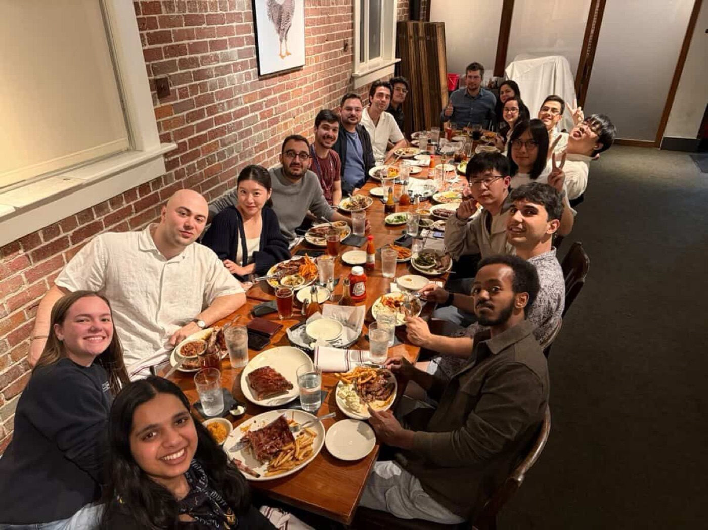
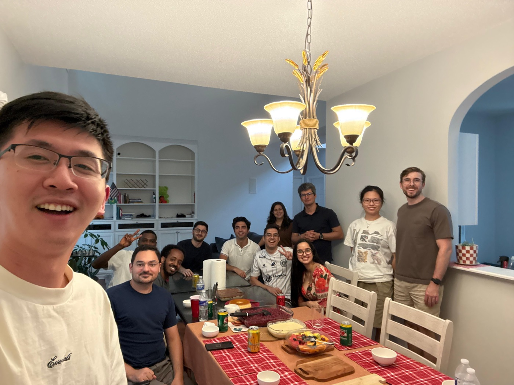
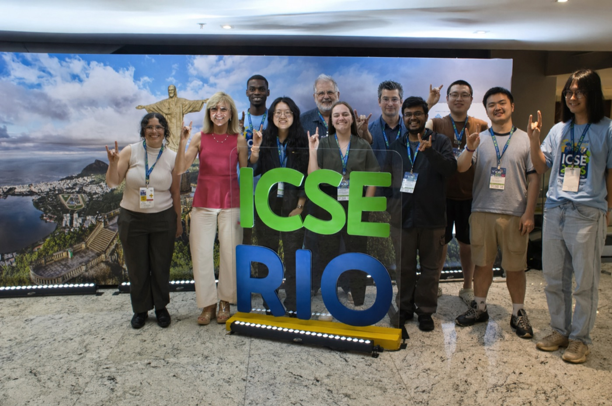
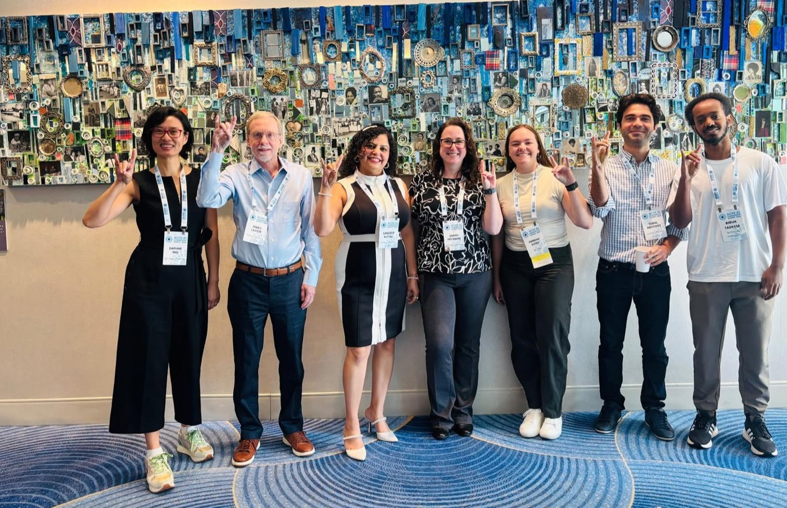

<a class="hiring" href="https://jobs.ncsu.edu/postings/237085"
   title="We're hiring: open-call Professor position, NC State Computer Science">
  <i class="fa-solid fa-certificate"></i>
  WE'RE HIRING
</a>

# <i class="fa-solid fa-paw"></i> SE @ ComSci, NC State

  <figure class="on"><figcaption>WISER lab dinner</figcaption></figure>
  <figure><figcaption>Research group lunch</figcaption></figure>
  <figure><figcaption>The NC State crew at ICSE 2026, Rio</figcaption></figure>
  <figure><figcaption>Wolfpack signs on the conference circuit</figcaption></figure>
  <button type="button" class="marquee-arrow prev" aria-label="Previous photo">&#10094;</button>
  <button type="button" class="marquee-arrow next" aria-label="Next photo">&#10095;</button>
  



| <i class="fa-solid fa-ranking-star badge40"></i> by the numbers | <i class="fa-solid fa-graduation-cap badge40"></i> study with us | <i class="fa-solid fa-handshake badge40"></i> work with us |
|----------------|---------------|--------------|
| By research output, a **top-five SE group in the US** ([CSRankings](https://csrankings.org/#/index?soft&us)).[**#11** US News undergrad SE](https://csc.ncsu.edu/2025/10/ncstatecs-software-engineering-program-shine-in-latest-u-s-news-rankings/) (2026, up from #17).Graduate CS [among US News' top-ranked programs](https://csc.ncsu.edu/2026/04/grad-programs-climb-atop-the-rankings/). | Eight [labs](faculty.html), one question: how to build better software.Pick your people: [faculty](faculty.html).Then apply via [grad office admissions](https://csc.ncsu.edu/academics/graduate/future-graduate-students/). | <a href="ai.html">How we use AI</a>Every [faculty](faculty.html) email is one click away &mdash; talk to us.Our tools and data ship: see below. |
{: .hero}

who we work with:AVLJPLLASSEIeBayMetaNASAENGELITPROGoogleTecgrafL3HarrisMicrosoftLexisNexisVolvo GroupArcelorMittal

<i class="fa-solid fa-screwdriver-wrench"></i> **tools &amp; data**[APICanvas](https://github.com/griffinht/apicanvas) ([try it](https://oas2tree2.vercel.app/)).[EVALOOOP](https://evalooop.github.io) (robustness leaderboard, 100+ LLMs).[EZR](https://pypi.org/project/ezr/).[i-toMicroservices](https://figshare.com/s/70a1be8007284c54aa96) (monolith decomposition).[MOOT](https://github.com/timm/moot) (100+ optimization tasks).[PairBuddy](https://skuttal.github.io/skk/research.html) (conversational pair-programming agent; CHI Honorable Mention).[PFIS-V](https://skuttal.github.io/skk/research.html) (predicts how programmers navigate code variants; CHI Best Paper).[PrioTestCI](https://github.com/ShubhamDesai/CI-Optimization) (CI test prioritization).[RemoteCollabEval](https://skuttal.github.io/skk/research.html) (finds inclusivity issues in remote-collaboration tools; DIS 2026 Honorable Mention).[Satsy](https://www.sciencedirect.com/science/article/abs/pii/S0164121215000874) (semantic code search).[Social Foraging Models](https://skuttal.github.io/skk/research.html) (how teams navigate repositories together; CHI 2026 Honorable Mention).[Visual Resume](https://skuttal.github.io/skk/research.html) (developer expertise from GitHub + Stack Overflow; ICGSE Best Paper).More: [HFXE lab](https://skuttal.github.io/skk/research.html) (PairEquity, Idea Garden, Pipes Plumber, and others).

<table>
  <thead>
    <tr>
      <th><i class="fa-solid fa-newspaper badge40"></i> news &amp; publications</th>
      <th><i class="fa-solid fa-trophy badge40"></i> honors</th>
    </tr>
  </thead>
  <tbody>
    <tr>
      <td markdown="span"> **On the ICSE 2026 main stage in Rio**: NC State work on LLM-assisted maintenance of the Robot Operating System (Assunção, Xu, and students). More: [pubs](pubs.html).  **Bowen Xu** to partner with Red Hat on [AI governance and safety](https://engr.ncsu.edu/news/2026/08/05/nc-state-engineering-and-red-hat-partner-on-ai-governance-and-safety/) — automated workflows that turn governance policy into production-ready systems.  Fresh this year at top venues: [Toward Agentic Runtime Healing](https://doi.org/10.1145/3800691) (Xu), **CACM**.[How Do Developers Interact with AI?](https://doi.org/10.1145/3808120) (Stolee), **FSE 2026**.[Testing Deep Learning Libraries via Neurosymbolic Constraint Learning](https://damorim.github.io/publications/Naziri_ETAL_ICSE26_1.pdf) (D'Amorim), **ICSE 2026**.On the Time Efficiency of Code Generated and Optimized by LLMs (Menzies), **IEEE TSE**. More: [news &amp; publications](pubs.html).</td>
      <td markdown="span">**Bowen Xu**: ACM SIGSOFT Distinguished Paper, ICPC 2026; IEEE TCSE Distinguished Paper, ICSME 2026.  **Honorable Mention at CHI 2026** for ["Where Will They Click Next?"](https://csc.ncsu.edu/2026/04/shahnewaz-leon-sandeep-kuttal-receive-honorable-mention-at-acm-chi/) (Shahnewaz Leon & Sandeep Kuttal) — top of 7,500+ submissions.  **Shandler Mason** (PhD student, HFXE): [DIS 2026 Honorable Mention](https://news.ncsu.edu/2026/05/improving-online-collaboration/) for her remote-collaboration paper.  **Tim Menzies**: ACM Fellow, IEEE Fellow, ASE Fellow, member of inaugural class of the [ACM SIGSOFT Software Engineering Academy](https://csc.ncsu.edu/2026/09/williams-menzies-inducted-into-inaugural-class-of-the-acm-sigsoft-software-engineering-academy/); named a 2026 Springer Nature Editor of Distinction (for EiC, [Automated SE](https://link.springer.com/journal/10515)).  **Wesley Assunção**: ACM SIGSOFT Distinguished Paper Award, FSE 2024, for "Understanding Developers' Discussions and Perceptions on Non-Functional Requirements: The Case of the Spring Ecosystem".  <i class="fa-solid fa-microphone-lines keynote-ico"></i> **Keynotes****Katie Stolee**: [FSE 2026 New Faculty Symposium](https://conf.researchr.org/track/fse-2026/fse-2026-new-faculty-symposium).**Sandeep Kuttal**: ACM SIGSOFT webinar; ETH Zurich.**Tim Menzies**: [ESEM 2025](https://timm.fyi/esem25.pdf); [SSBSE 2026](https://timm.fyi/26less.pdf); [open source @ Cloud Native RTP 2026](pdfs/26oss.pdf).**Wesley Assunção**: [SPLC 2025 Doctoral Symposium](https://wesleyklewerton.github.io/publications/SPLC2025_DoctoralSymposium_2025Sept.pdf); [GI @ ICSE 2026](https://wesleyklewerton.github.io/cv.html).More: [keynotes](keynotes.html).</td>
    </tr>
  </tbody>
</table>

<table class="service">
  <thead>
    <tr>
      <th><i class="fa-solid fa-handshake badge40"></i> service</th>
    </tr>
  </thead>
  <tbody>
    <tr>
      <td markdown="span">**Journal boards**: Tim Menzies ([EMSE](https://link.springer.com/journal/10664/editorial-board) advisory board; [IST](https://www.sciencedirect.com/journal/information-and-software-technology/about/editorial-board), [JSS](https://www.sciencedirect.com/journal/journal-of-systems-and-software/about/editorial-board) editorial boards); Bowen Xu (EMSE); Wesley Assunção (In Practice Editor, JSS).**ICSE 2028**: Tim Menzies (FOSE Co-Chair), Wesley Assunção (Student Volunteer Chair).**ICSE** PC 2025&ndash;27: Bowen Xu (Review Process Co-Chair 2025, 2027), Marcelo D'Amorim, Tim Menzies (Area Co-Chair 2026).**FSE** PC 2025&ndash;27: Bowen Xu (Review Process Co-Chair 2025), John-Paul Ore, Tim Menzies, Wesley Assunção.**ASE** PC 2025&ndash;26: Marcelo D'Amorim, Sandeep Kuttal, Tim Menzies (Area Chair 2026).**MSR** PC 2025&ndash;27: Katie Stolee, Wesley Assunção, Tim Menzies, Nusrat Zahan.**Katie Stolee**: Program Chair, ICSE NIER 2026.**Marcelo D'Amorim**: General Chair, [FSE 2024](https://2024.esec-fse.org/).**Sandeep Kuttal**: General Chair, VL/HCC 2026.**Tim Menzies**: Editor-in-Chief, [Automated SE](https://link.springer.com/journal/10515).**Wesley Assunção**: Program Co-Chair, SSBSE 2026.</td>
    </tr>
  </tbody>
</table>
