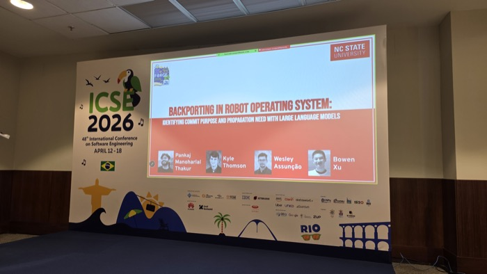

# <i class="fa-solid fa-paw"></i> Software Engineering @ NC State

| <i class="fa-solid fa-ranking-star badge40"></i> by the numbers | <i class="fa-solid fa-graduation-cap badge40"></i> study with us | <i class="fa-solid fa-handshake badge40"></i> work with us |
|----------------|---------------|--------------|
| By research output, a **top-five SE group in the US** ([CSRankings](https://csrankings.org/#/index?soft&us)).[**#11** US News undergrad SE](https://csc.ncsu.edu/2025/10/ncstatecs-software-engineering-program-shine-in-latest-u-s-news-rankings/) (2026, up from #17).Graduate CS [among US News' top-ranked programs](https://csc.ncsu.edu/2026/04/grad-programs-climb-atop-the-rankings/). | Eight [labs](faculty.html), one question: how to build better software.Pick your people: [faculty](faculty.html).Then apply via [grad office admissions](https://csc.ncsu.edu/academics/graduate/future-graduate-students/). | Our tools and data ship: [EVALOOOP](https://evalooop.github.io) (robustness leaderboard, 100+ LLMs), [EZR](https://pypi.org/project/ezr/), [MOOT](https://github.com/timm/moot) (100+ optimization tasks), and more.See [how we use AI](ai.html).Every [faculty](faculty.html) email is one click away &mdash; talk to us. |

<table>
  <thead>
    <tr>
      <th><i class="fa-solid fa-newspaper"></i> news</th>
      <th><i class="fa-solid fa-trophy"></i> honors</th>
    </tr>
  </thead>
  <tbody>
    <tr>
      <td markdown="span"> **On the ICSE 2026 main stage in Rio**: NC State work on LLM-assisted maintenance of the Robot Operating System (Assunção, Xu, and students). More: [pubs](pubs.html).  **Honorable Mention at CHI 2026** for ["Where Will They Click Next?"](https://csc.ncsu.edu/2026/04/shahnewaz-leon-sandeep-kuttal-receive-honorable-mention-at-acm-chi/) (Leon & Kuttal) — top of 7,500+ submissions.  More: [news archive](news.html).</td>
      <td markdown="span">**Bowen Xu**: ACM SIGSOFT Distinguished Paper, ICPC 2026; IEEE TCSE Distinguished Paper, ICSME 2026.  **Shahnewaz Leon** (PhD student, HFXE): [CHI 2026 Honorable Mention](https://csc.ncsu.edu/2026/04/shahnewaz-leon-sandeep-kuttal-receive-honorable-mention-at-acm-chi/) for "Where Will They Click Next?" — top of 7,500+ submissions.  **Shandler Mason** (PhD student, HFXE): [DIS 2026 Honorable Mention](https://news.ncsu.edu/2026/05/improving-online-collaboration/) for her remote-collaboration paper.  **Tim Menzies**: member, inaugural class of the [ACM SIGSOFT Software Engineering Academy](https://csc.ncsu.edu/2026/09/williams-menzies-inducted-into-inaugural-class-of-the-acm-sigsoft-software-engineering-academy/) (2026); ACM Fellow, IEEE Fellow, ASE Fellow.</td>
    </tr>
  </tbody>
</table>

<table>
  <thead>
    <tr>
      <th><i class="fa-solid fa-handshake"></i> service</th>
    </tr>
  </thead>
  <tbody>
    <tr>
      <td markdown="span">**Katie Stolee**: Program Chair, ICSE NIER 2026.**Marcelo D'Amorim**: General Chair, [FSE 2024](https://2024.esec-fse.org/).**Sandeep Kuttal**: General Chair, VL/HCC 2026.**Tim Menzies**: Editor-in-Chief, [Automated SE](https://link.springer.com/journal/10515).**Journal boards**: Tim Menzies ([EMSE](https://link.springer.com/journal/10664/editorial-board), [IST](https://www.sciencedirect.com/journal/information-and-software-technology/about/editorial-board), [JSS](https://www.sciencedirect.com/journal/journal-of-systems-and-software/about/editorial-board)); Bowen Xu (EMSE); Wesley Assunção (In Practice Editor, JSS).**ICSE** PC 2025&ndash;27: Bowen Xu (Review Process Co-Chair 2025, 2027), Marcelo D'Amorim, Tim Menzies (Area Co-Chair 2026).**FSE** PC 2025&ndash;27: Bowen Xu (Review Process Co-Chair 2025), John-Paul Ore, Tim Menzies, Wesley Assunção.**ASE** PC 2025&ndash;26: Marcelo D'Amorim, Sandeep Kuttal, Tim Menzies (Area Chair 2026).**MSR** PC 2025&ndash;27: Katie Stolee, Wesley Assunção, Tim Menzies, Nusrat Zahan.</td>
    </tr>
  </tbody>
</table>
