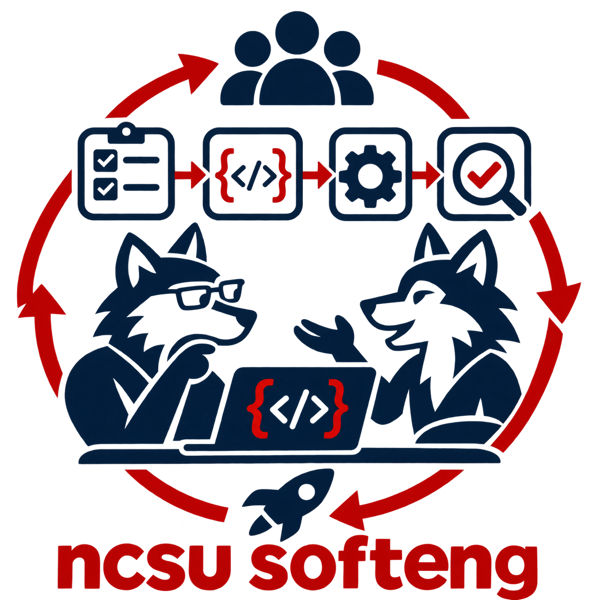

<a href="./">home</a> ·
<a href="news.html">news</a> ·
<a href="pubs.html">pubs</a> ·
<a href="faculty.html">faculty</a> ·
<a href="students.html">students</a> ·
<a href="labs.html">labs</a>

<small>
<a href="https://timm.fyi/irl.html">Irrational Research</a> (Tim Menzies) ·
<a href="https://skuttal.github.io/skk/research.html">HFXE</a> (Sandeep Kuttal) ·
<a href="https://ncsu-softmax.github.io/">SoftMax</a> (Bowen Xu) ·
The Testable Team (Marcelo D'Amorim) ·
<a href="https://kstolee.github.io/">The Perspective People</a> (Katie Stolee) ·
<a href="https://jpwco.com/">Robust Robots</a> (John-Paul Ore) ·
<a href="https://sheckman.github.io/">Super SE Teaching Lab</a> (Sarah Heckman) ·
<a href="https://wesleyklewerton.github.io/">The Evolve Group</a> (Wesley Assunção)
</small>

# Faculty

Alphabetical, by first name. Pic and one paragraph each.
