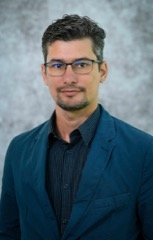
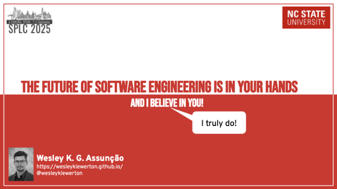
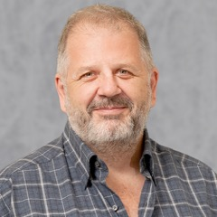
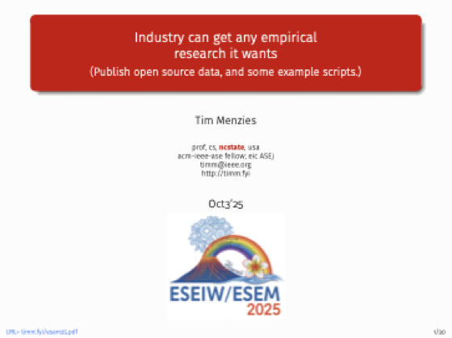
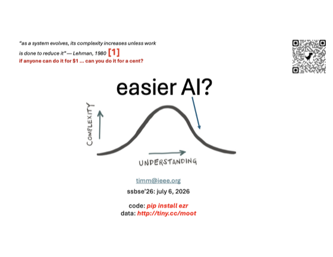
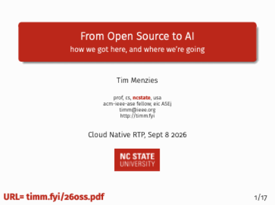

<a class="hiring" href="https://jobs.ncsu.edu/postings/237085"
   title="We're hiring: open-call Professor position, NC State Computer Science">
  <i class="fa-solid fa-certificate"></i>
  WE'RE HIRING
</a>

# <i class="fa-solid fa-microphone-lines"></i> Keynotes & Talks

Recent keynotes and invited addresses, 2024&ndash;26. Click a slide to get the full deck.

|  |  |
|--|--|
|  | **Katie Stolee** — invited speaker, [FSE 2026 New Faculty Symposium](https://conf.researchr.org/track/fse-2026/fse-2026-new-faculty-symposium) (Montreal): *Flexibility and Broader Perspectives for New Faculty Life*. |
|  | **Sandeep Kuttal** — keynote and invited talks: [**Int'l Conf. on HCI and Cognitive Computing 2024**](https://skuttal.github.io/skk/Files/Kuttal_CV.pdf) (India, keynote): *Software Engineering Dynamics: Linking Technical and Human-Centric Factors*.[**ACM SIGSOFT webinar**](https://www2.sigsoft.org/activities/webinarsmain/) (2026): *AI Won't Fix Software Engineering. People Will*.**ETH Zurich** (2026): *Toward Collective Intelligence: Designing Behavior-Aware Collaboration Workflows*.**Imperial College London** (2024): *IDEs as the Bridge: Connecting Humans and Code*.**VL/HCC 2024** (Liverpool): *Developers' Information Seeking in Q&A Websites through a Gender Lens*.And the *IDEs as the Bridge* world tour: PUC-Rio and UF Amazonas (Brazil), UP Valencia (Spain), Open University (Netherlands), all 2024. |
|  | **Wesley Assunção** — two keynotes: [**SPLC 2025 Doctoral Symposium**](https://wesleyklewerton.github.io/publications/SPLC2025_DoctoralSymposium_2025Sept.pdf): *The Future of Software Engineering is in your hands, and I believe in you!*[**GI @ ICSE 2026**](https://wesleyklewerton.github.io/cv.html): *Genetic Improvement for Software Modernization, Synergy and Opportunities*.  |
|  | **Tim Menzies** — three keynotes: [**ESEM 2025**](https://timm.fyi/esem25.pdf) (Honolulu): *Industry can get any empirical research it wants*.[**SSBSE 2026**](https://timm.fyi/26less.pdf) (Montreal, with FSE): *The Other Side of Complexity*.[**Cloud Native RTP 2026**](pdfs/26oss.pdf) (Raleigh): *From Open Source to AI*.    |
{:.plain .bands}
