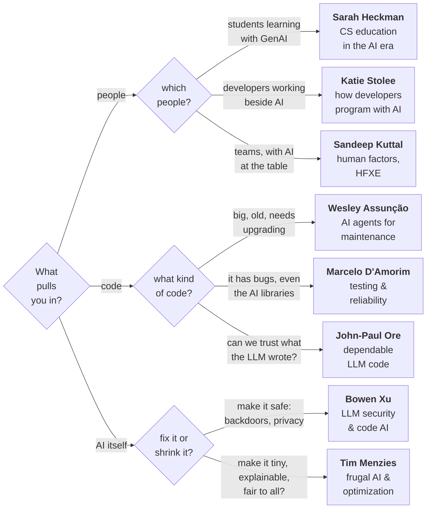

<a class="hiring" href="https://jobs.ncsu.edu/postings/237085"
   title="We're hiring: open-call Professor position, NC State Computer Science">
  <i class="fa-solid fa-certificate"></i>
  WE'RE HIRING
</a>

# <i class="fa-solid fa-signs-post"></i> Pick Your Professor

Three questions, eight answers, no wrong turns.

Found your person? Email, bio, and lab link: [faculty](faculty.html).
