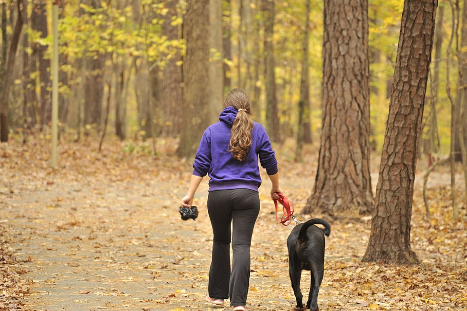
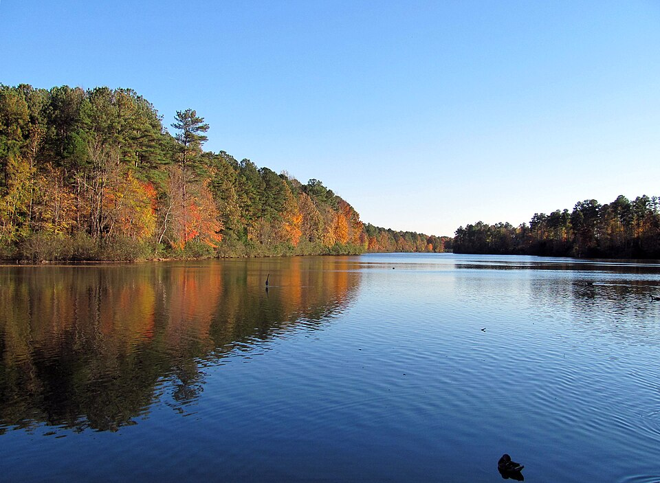
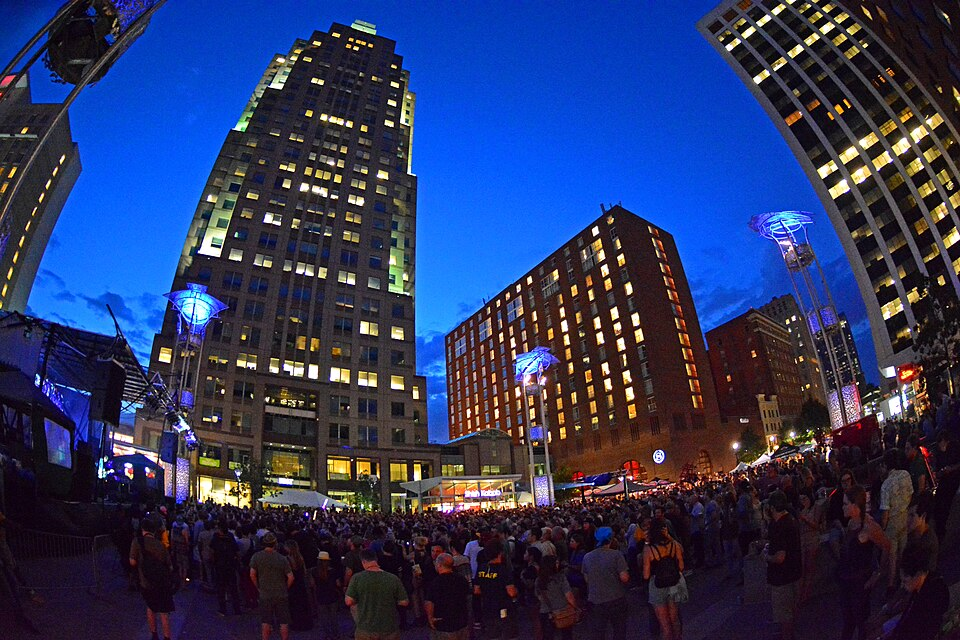
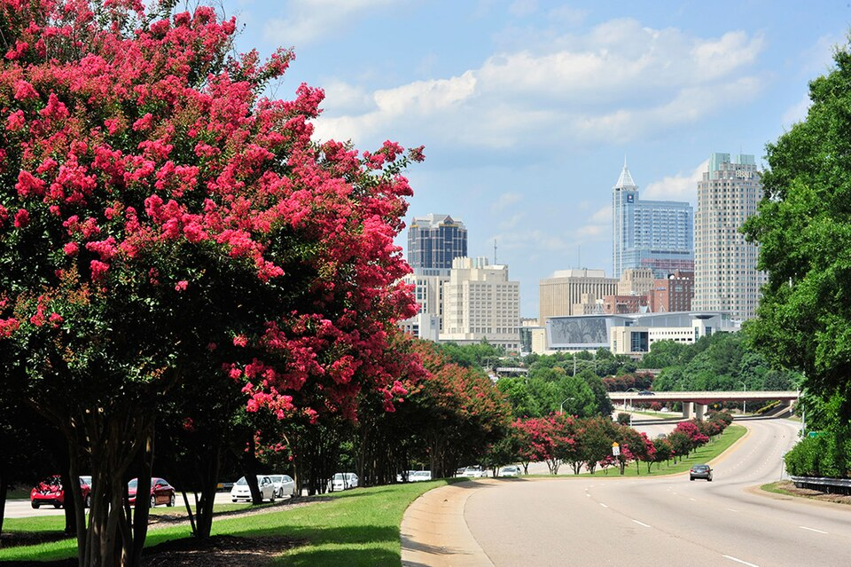
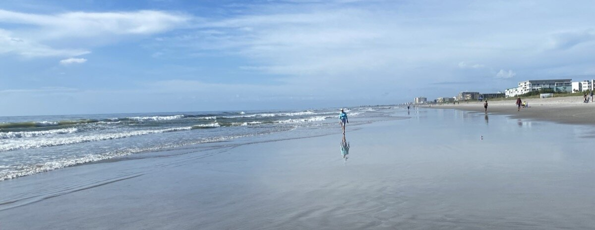
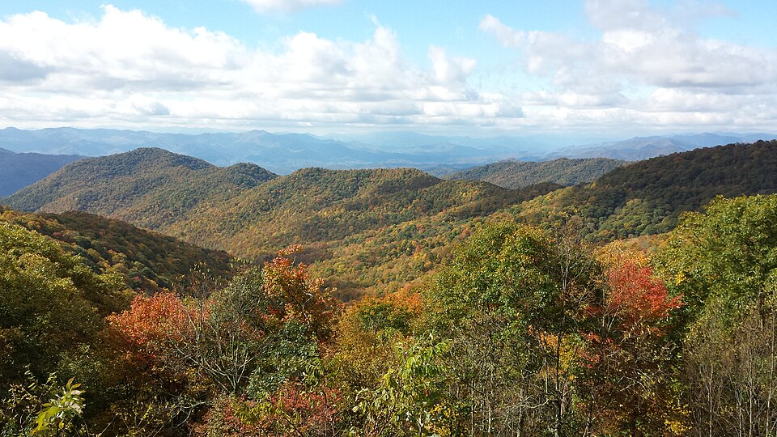

# <i class="fa-solid fa-tree-city"></i> Why Live in Raleigh?

**It's affordable.** Cost of living sits at the [national
average](https://www.salary.com/research/cost-of-living/raleigh-nc)
(housing ~14% below) — roughly **40% cheaper than Boston**, and
far below the Bay Area or Seattle.

**Four gentle seasons.** Humid subtropical: long springs and
falls, hot summers, mild winters where snow is an event, and
sunshine most of the year.

**Green campus, green city.** Raleigh is the "City of Oaks":
200+ parks under a forest-like canopy. NC State sits on 2,000
oak-shaded acres next to
[Pullen Park](https://raleighnc.gov/parks/pullen-park), with 180
miles of the
[Capital Area Greenway](https://raleighnc.gov/parks/capital-area-greenway-trail-system)
threading the city.

 <small>On the greenway
([photo](https://commons.wikimedia.org/wiki/File:Girl_walking_dog_at_Lake_Johnson.jpg):
Wikimedia Commons, CC BY-SA 4.0)</small>

**Water and woods, minutes away.** [Lake
Johnson](https://raleighnc.gov/parks/lake-johnson-park) and Lake
Raleigh border campus; [Umstead State
Park](https://www.ncparks.gov/state-parks/william-b-umstead-state-park)'s
5,000 acres of trails are 15 minutes out; Falls and Jordan lakes
bracket the Triangle.

 <small>Lake Lynn in fall
([photo](https://commons.wikimedia.org/wiki/File:Lake_Lynn_Raleigh.jpg):
Wikimedia Commons, CC BY-SA 3.0)</small>

**A real downtown.** Free state museums ([Natural
Sciences](https://naturalsciences.org/), History, the [Museum of
Art](https://ncartmuseum.org/), and [CAM](https://camraleigh.org/)
for the gloriously weird), James Beard-winning chefs, food
halls in the Warehouse District, dozens of local breweries — all
inside a 10-minute drive. The scene stays loud after dark:
[Hopscotch](https://hopscotchmusicfest.com/) and Dreamville
festivals, Red Hat Amphitheater, First Friday art walks, and
clubs across Glenwood South.

 <small>Hopscotch Music Festival, City Plaza
([photo](https://commons.wikimedia.org/wiki/File:City_Plaza,_Hopscotch_Music_Festival_(21700983598).jpg):
Wikimedia Commons, CC BY-SA 2.0)</small>

**A booming tech hub.** The [Research
Triangle](https://en.wikipedia.org/wiki/Research_Triangle) —
Raleigh, Durham, Chapel Hill — ranks among the fastest-growing
STEM job markets in the US: Research Triangle Park alone packs
200+ companies and 50,000 jobs into 7,000 acres. Forbes calls
Raleigh the fifth most-educated city in America.

 <small>Crepe myrtles against the skyline
([photo](https://commons.wikimedia.org/wiki/File:Raleigh_skyline_along_S_Saunders_st.jpg):
Wikimedia Commons, CC BY-SA 4.0)</small>

**Beaches, mountains, and the world.** Wrightsville Beach is two
hours east (Crystal Coast and Outer Banks a little further); the
Blue Ridge Mountains around Asheville — overlooks, waterfalls,
and the parkway's endless ridgelines — are four hours west.
[RDU](https://www.rdu.com/), 20 minutes from campus, flies
nonstop to ~85 destinations — including London, Paris, Frankfurt,
Dublin, and Reykjavik.

 <small>Blue Ridge Parkway, west of Asheville
([photo](https://commons.wikimedia.org/wiki/File:Autumn_along_Blue_Ridge_Parkway.jpg):
Wikimedia Commons, CC BY-SA 4.0)</small>
