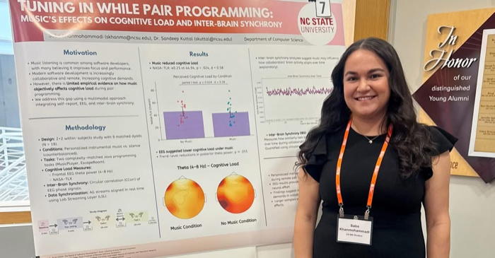
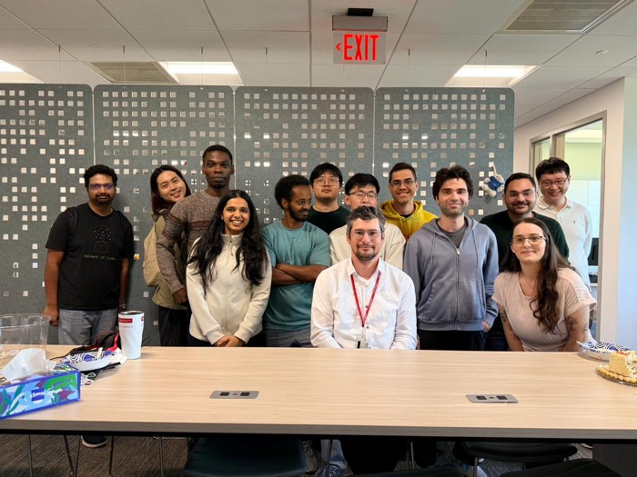
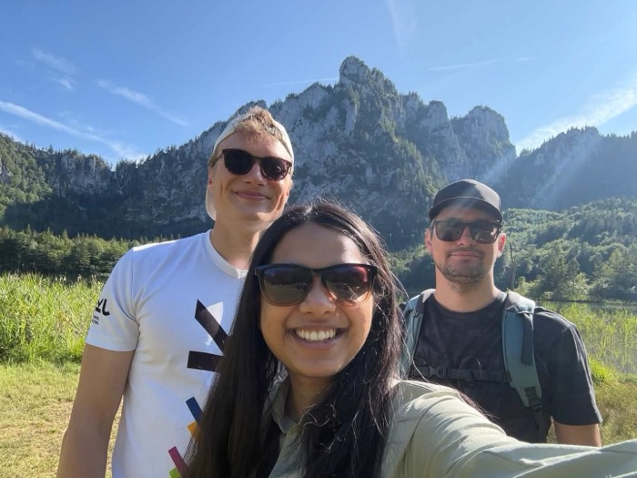

# <i class="fa-solid fa-medal"></i> Student Life

Our students defend PhDs, win paper awards, intern on three
continents, and occasionally climb a mountain. Highlights by lab
(every lab: send us your wins!).

## HFXE Lab (Sandeep Kuttal), 2026

- Shandler Mason earned her PhD and joined Norfolk State as
  tenure-track faculty
  ([feature](https://engr.ncsu.edu/news/2026/04/29/shandler-mason-human-centered-software-engineering/));
  her remote-collaboration paper took an **Honorable Mention at
  ACM DIS 2026**
  ([NC State News](https://news.ncsu.edu/2026/05/improving-online-collaboration/)).
- Shahnewaz Leon defended his PhD; his "Where Will They Click
  Next?" earned an **Honorable Mention at ACM CHI 2026**
  ([feature](https://csc.ncsu.edu/2026/04/shahnewaz-leon-sandeep-kuttal-receive-honorable-mention-at-acm-chi/)).
- Sandeep Sthapit defended his PhD and joined a liberal arts
  college as teaching faculty.
- Saba Khanmohammadi finished her master's, stayed for the PhD
  ([feature](https://csc.ncsu.edu/2026/10/saba-khanmohammadi-from-masters-to-ph-d/)),
  won a **Provost Doctoral Fellowship**, and interned at IBM —
  twice.
- Manali Tekes completed an international internship in Germany
  ([feature](https://csc.ncsu.edu/2026/10/manali-tekes-internship-abroad/));
  lab students presented **seven papers at HCII 2026**.

## The Evolve Group (Wesley Assunção)

The lab, at work and (right) decidedly not at work. Evolve
students also presented at ICSE 2026 in Rio — see the
[front page](./).

## Your lab here

Six more labs' worth of wins belong on this page. Faculty: drop
items in the intray.
